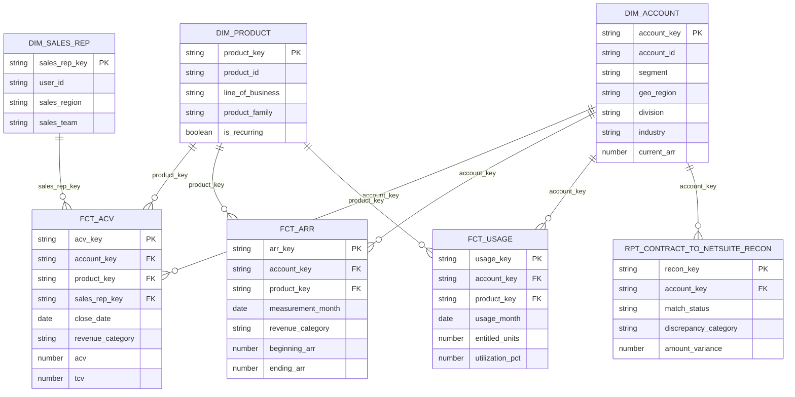
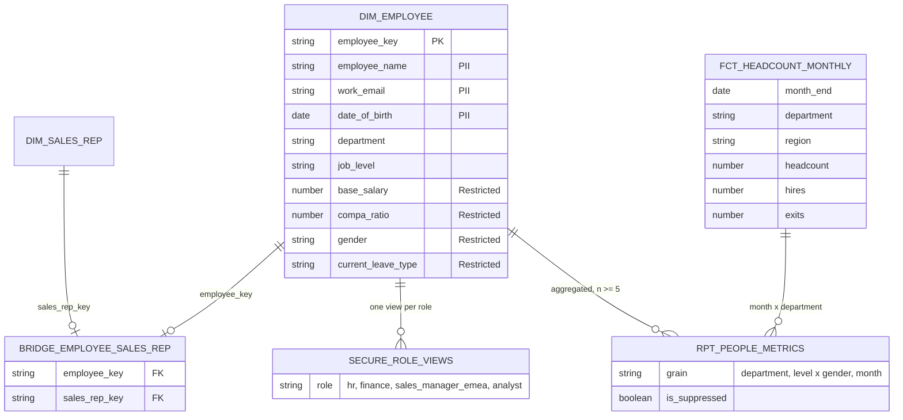
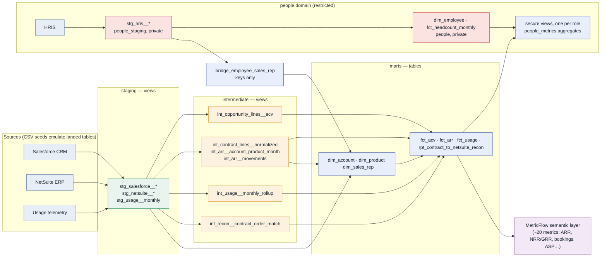
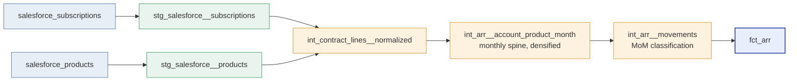
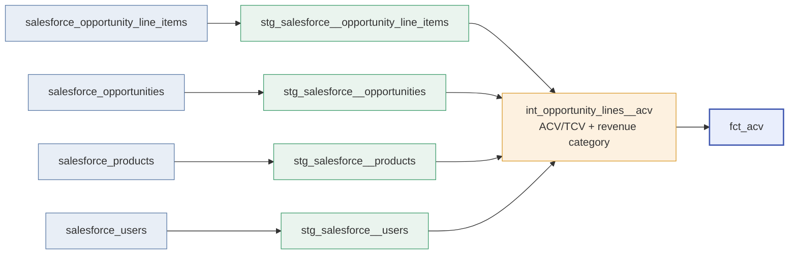
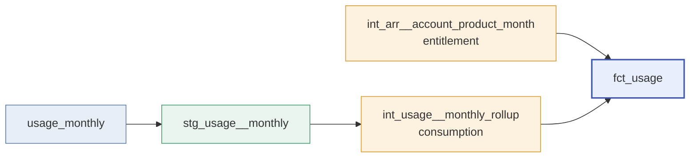
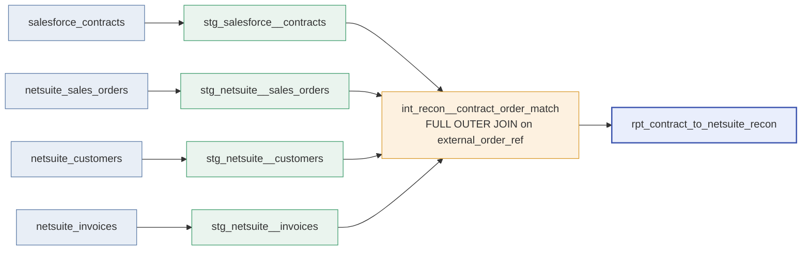
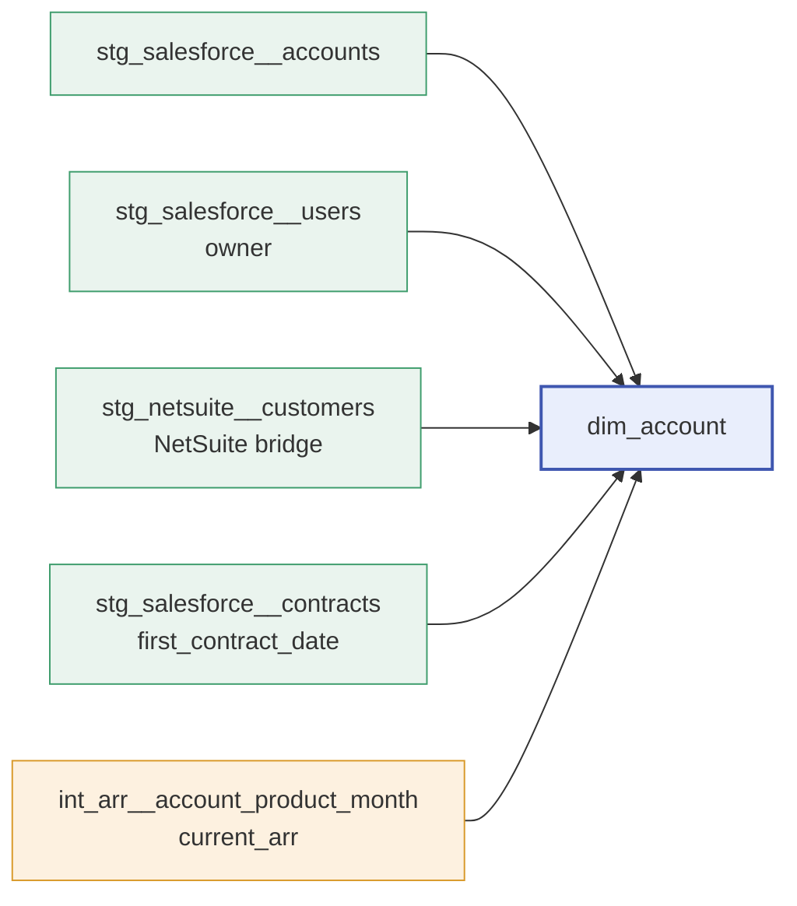
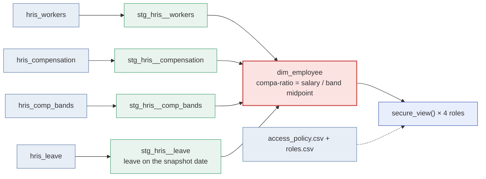

# Data model — ERD & lineage

How the marts relate to each other (ERDs), and how each one is built up from its
sources (DAGs). Two domains: **revenue** (Salesforce, NetSuite, usage) and **people**
(the HRIS). All diagrams are Mermaid and render directly on GitHub. Who may see which
columns is in [GOVERNANCE.md](GOVERNANCE.md).

---

## Revenue: entity-relationship diagram (the star schema)

Three conformed dimensions fan out to four facts via surrogate keys
(`account_key`, `product_key`, `sales_rep_key`).

**Grains:** `fct_acv` = one opportunity line · `fct_arr` = account × product × month-end ·
`fct_usage` = account × product × month · `rpt_contract_to_netsuite_recon` = contract ↔ order.

---

## People: entity-relationship diagram

The people domain is restricted. `dim_employee` and `fct_headcount_monthly` are
private to People Analytics; everything else reads role-scoped secure views or the
suppressed aggregates in `people_metrics`. The revenue domain joins in through a
bridge that carries keys only.

**Grains:** `dim_employee` = one person ever employed · `fct_headcount_monthly` =
month-end × department × region · `rpt_people__department_summary` = department ·
`rpt_people__pay_equity` = job level × gender · `rpt_people__revenue_per_employee` = month-end.

---

## End-to-end lineage

Sources → seeds → staging (views) → intermediate (views) → marts (tables) → semantic layer,
with the people domain alongside: its own schemas, its own owner, and secure views on the way out.

---

## How each mart is built

### `fct_arr` — the ARR waterfall

### `fct_acv` — bookings & pipeline

### `fct_usage` — consumption vs entitlement

### `rpt_contract_to_netsuite_recon` — Salesforce ↔ NetSuite

### `dim_account` — conformed customer dimension

> `dim_product` (stg_salesforce__products + stg_netsuite__items) is a direct staging →
> dimension build-up. `dim_sales_rep` is stg_salesforce__users plus the employee key from
> the people domain's bridge.

### `dim_employee`: the restricted core of the people domain

