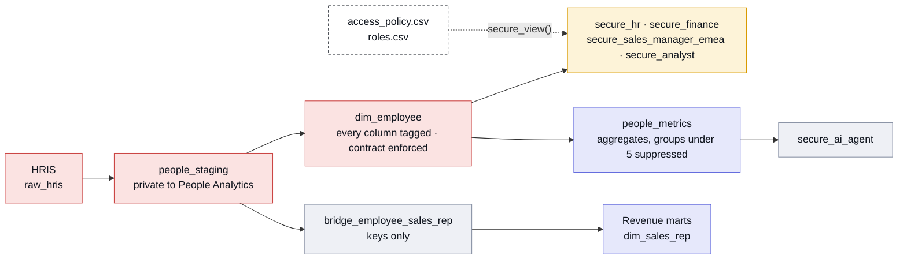

# Governance: who sees what

Every column that describes a person is classified where it enters the warehouse.
One policy file decides what each role sees. The build proves nothing leaks.

That's the whole system. The rest of this page shows how each part works and
where it lives in the code.

---

## Four classes

| Class | What it means | Examples in this repo |
|---|---|---|
| **Internal** | About the business, not a person | department, region, product, usage |
| **Confidential** | Business-sensitive | customer revenue, job level, hire dates, pay-band midpoints |
| **PII** | Identifies a person | name, email, birth date, home postal code, employee id |
| **Restricted** | Could hurt a person if it leaked | pay, leave (health information), gender |

Each column carries its class and a category in its YAML:

```yaml
- name: base_salary
  data_type: integer
  description: Annual base salary, USD. Shown to analysts as a $20k band.
  config: {meta: {sensitivity: restricted, category: comp, band: salary}}
```

---

## The policy

[`seeds/governance/access_policy.csv`](seeds/governance/access_policy.csv) is the
single source of truth. GitHub renders it as a table, and dbt loads it as a seed:

| Category | Class | HR partner | Finance | Sales manager, EMEA | Analyst | AI agent |
|---|---|---|---|---|---|---|
| identity (name, ids) | PII | full | pseudonymize | full | pseudonymize | hide |
| work contact (email) | PII | full | mask | full | mask | hide |
| personal (birth date, home) | PII | full | hide | hide | band | hide |
| org (department, title, region) | Internal | full | full | full | full | hide |
| employment (level, dates) | Confidential | full | full | full | full | hide |
| comp (pay, bonus, equity) | Restricted | full | full | hide | band | hide |
| health (leave) | Restricted | full | hide | flag | hide | hide |
| demographic (gender) | Restricted | full | hide | hide | hide | hide |

What each treatment does:

| Treatment | Example | Why |
|---|---|---|
| full | `Priya Raman` | The role owns or needs this data |
| pseudonymize | `Employee 3F2A1C` | A salted hash. Stable, so counts and joins still work; not reversible without the salt |
| mask | `p•••@saasco.com` | Enough to recognise a format, not a person |
| band | `$120-140k`, `30s` | Enough to analyse, not enough to single anyone out |
| flag | `Away` | A manager needs to know someone is out, not why |
| hide | (no column) | The column is not in the view at all |

[`seeds/governance/roles.csv`](seeds/governance/roles.csv) adds one more rule per
role: a row filter. The EMEA sales manager sees `department = 'Sales' and region = 'EMEA'`.

The AI agent gets no person-level rows at all. It answers people questions from
the suppressed aggregates in `people_metrics`, so "what's the average pay on the
Legal team?" has no answer: Legal has three people.

---

## How it works



1. **Tag.** Every people column has `sensitivity` and `category` in YAML.
2. **Decide.** `access_policy.csv` maps each category to a treatment per role.
3. **Generate.** Each role's view is one line,
   `{{ secure_view('dim_employee', 'analyst') }}`. The macro
   ([`macros/governance/secure_view.sql`](macros/governance/secure_view.sql))
   reads the tags and the policy and writes the SQL. Nobody writes a secure view
   by hand.

### Private by default

- **A column with no tag is hidden from every role.** Forget to classify a new
  column and it simply doesn't show up anywhere outside HR's own tables.
- **Raw HR models are `access: private`** to the People Analytics group. A
  revenue model that tries to `ref()` them fails to compile:
  `...is not allowed because the referenced node is private to the 'people' group.`
- **People data lives in its own schemas** (`raw_hris`, `people_staging`,
  `people`), so one warehouse grant locks all of it down.
- **Small groups are suppressed.** No people metric is shown for fewer than 5
  people (`var('min_group_size')`), because a number about two people is a
  number about a person.
- **Other domains get keys, never records.** Revenue joins to people through
  `bridge_employee_sales_rep`, which holds two hashed keys and nothing else.

---

## The proof

These run on every `dbt build`. Each returns the rows that break the rule, so
zero rows is a pass.

| Test | What it proves |
|---|---|
| [`assert_no_pii_leaks`](tests/assert_no_pii_leaks.sql) | No masked, pseudonymized, banded or flagged value equals the raw value, and every hidden column is really absent from the view |
| [`assert_restricted_never_reaches_analyst_or_ai`](tests/assert_restricted_never_reaches_analyst_or_ai.sql) | The policy gives analysts and the AI agent nothing restricted except bands; analysts see only bands; the AI schema has no person-level column |
| [`assert_row_filters_hold`](tests/assert_row_filters_hold.sql) | The EMEA manager's view holds exactly the rows the filter allows: none extra, none missing |
| [`assert_small_groups_suppressed`](tests/assert_small_groups_suppressed.sql) | No metric shown for a group under 5, recounted independently from `dim_employee` |

The tests read the same policy file, so a new role or a new column is covered
without editing them. They also guard the policy itself. Change the analyst's
`comp` rule from `band` to `full` and the build fails, with one row per pay
column it would expose. Widen the EMEA view beyond its filter and
`assert_row_filters_hold` fails too.

### Ownership

- Every model belongs to a group with a named owner ([`models/groups.yml`](models/groups.yml)).
- Certified models (`fct_arr`, `fct_acv`, `dim_employee`) have **enforced
  contracts**: a change to a column's name or type fails the build instead of
  breaking a dashboard.
- [`scripts/check_governance.py`](scripts/check_governance.py) runs in CI after
  `dbt build`. It fails if any model has no owner or description, if any
  people-domain column is unclassified, or if any column anywhere looks like
  personal data (an email, a birth date, pay, a person's name) without a tag.

---

## In production

Locally, DuckDB has no users, so the boundaries are schemas, views and tests. On
BigQuery the same policy becomes warehouse-enforced access. Reference files, not
run locally:

| Here | In BigQuery | File |
|---|---|---|
| One schema per role | One dataset per role, granted to one group | [`01_grants.sql`](governance/bigquery/01_grants.sql) |
| `row_filter` in `roles.csv` | Row access policy on `dim_employee` | [`02_row_access_policies.sql`](governance/bigquery/02_row_access_policies.sql) |
| `sensitivity` tags in YAML | Policy tags and masking rules on the columns | [`03_column_security.tf`](governance/bigquery/03_column_security.tf) |
| Secure views read a private table | Authorized views (`grant_access_to` in dbt) | `01_grants.sql` |
| `local-demo-salt` | Salt from a secret store (`PSEUDONYM_SALT`) | `dbt_project.yml` |
